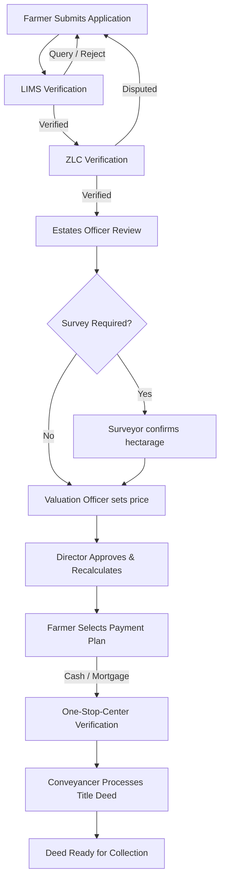

# Online Deed Application Portal

[](https://www.djangoproject.com/)
[](https://react.dev/)
[](https://vitejs.dev/)
[](https://www.postgresql.org/)
[](https://redis.io/)

A modern, full-stack application designed to streamline the processing, verification, valuation, and issuance of land title deeds. The system automates interactions between farmers, LIMS (Land Information Management System), ZLC (Zimbabwe Land Commission), surveyors, estates officers, valuation officers, and conveyancers.

---

## 🏗️ System Workflow

The system manages the lifecycle of a deed application through distinct review stages:



---

## 🛠️ Tech Stack

### Backend
- **Core**: Python 3.12, Django 5.2
- **API**: Django REST Framework (DRF) 3.16
- **Database**: PostgreSQL (main storage), SQLite (fallback/testing)
- **Caching & Rate Limiting**: Redis, `django-redis`
- **Mail Logs**: In-app asynchronous database email log queue

### Frontend
- **Core**: React 18, Vite 5
- **Testing**: Vitest, React Testing Library
- **Styling**: Vanilla CSS with modern premium styling (HSL variables, glassmorphism, responsive grid layouts)

---

## 🚀 Getting Started

### Prerequisites
Make sure you have the following installed:
- [Python 3.12+](https://www.python.org/downloads/)
- [Node.js 18+](https://nodejs.org/)
- [PostgreSQL 16](https://www.postgresql.org/download/)
- [Redis 7+](https://redis.io/download/)

---

### 1. Backend Setup

1. **Navigate to the root directory**:
   ```bash
   cd onlineapplication
   ```

2. **Create and activate a virtual environment**:
   ```bash
   python -m venv venv
   # On Windows:
   .\venv\Scripts\activate
   # On macOS/Linux:
   source venv/bin/activate
   ```

3. **Install Dependencies**:
   ```bash
   pip install -r requirements.txt
   ```

4. **Environment Variables**:
   Copy the example template file and configure your database/email credentials:
   ```bash
   cp .env.example .env
   ```
   Open `.env` and fill in your PostgreSQL password and Redis configuration.

5. **Run Database Migrations**:
   ```bash
   python manage.py migrate
   ```

6. **Create a Superuser** (for admin panel access):
   ```bash
   python manage.py createsuperuser
   ```

7. **Start the Development Server**:
   ```bash
   python manage.py runserver
   ```
   The backend API will be available at `http://127.0.0.1:8000/`.

---

### 2. Frontend Setup

1. **Navigate to the frontend folder**:
   ```bash
   cd frontend
   ```

2. **Install Node modules**:
   ```bash
   npm install
   ```

3. **Start the Vite dev server**:
   ```bash
   npm run dev
   ```
   The application UI will be running at `http://localhost:5173/`.

---

## 🧪 Running Tests

### Backend Unit Tests
We use Django's test runner to execute backend unit, integration, and API tests:
```bash
# From the root directory:
.\venv\Scripts\python.exe manage.py test
```
All unit tests are consolidated in the `onlineapplicationapi/tests/` subdirectory:
- `test_models.py`: Database integrity and model constraints.
- `test_serializers.py`: API serialization and validation checks.
- `test_pricing_compounded.py`: Compounded rate calculations & war veteran concession thresholds.
- `test_file_security.py`: Secure file path obfuscation and document accessibility rules.
- `test_officer_assisted_application.py`: Checks for officer-assisted registration.
- `test_integration.py`: End-to-end user workflows.

### Frontend Unit & UI Tests
We use Vitest to run frontend component and page tests:
```bash
# From the frontend directory:
npm run test
```

---

## 📂 Project Directory Structure

```text
onlineapplication/
│
├── frontend/                     # React Single Page Application (SPA)
│   ├── src/
│   │   ├── components/           # Reusable UI elements (Breadcrumbs, Modals, Badges)
│   │   ├── pages/                # Dashboards & Forms (Officer Dashboard, Farmer Dashboard, etc.)
│   │   └── index.css             # Unified CSS design variables
│   └── package.json
│
├── onlineapplication/            # Django main configuration settings
│   ├── settings.py               # Core application and database setup
│   └── urls.py                   # Main route routing
│
├── onlineapplicationapi/         # Main application Django App
│   ├── models.py                 # DB schemas (FarmerProfile, TitleDeedApplication)
│   ├── views.py                  # API views & custom actions (Verify LIMS, set pricing)
│   ├── pricing.py                # Business logic: purchase price & discounts calculation
│   ├── services/                 # Verification and email services layer
│   └── tests/                    # Consolidated Python unit tests suite
│
├── .env.example                  # Environment configuration template
├── requirements.txt              # Backend pip dependencies list
└── manage.py                     # Django execution utility
```

---

## 🤝 Contribution Guidelines

- **Branch Naming**: Use descriptive branch names like `feature/feature-name` or `bugfix/issue-description`.
- **Code Style**: 
  - Python: Follow PEP 8 guidelines. Keep imports clean and absolute.
  - React: Keep components focused, clean up unused imports, and avoid Tailwind CSS classes (stick to the central vanilla design system in `index.css`).
- **Tests**: Ensure any new features or endpoints are fully covered with new unit test cases inside the `onlineapplicationapi/tests/` folder.
